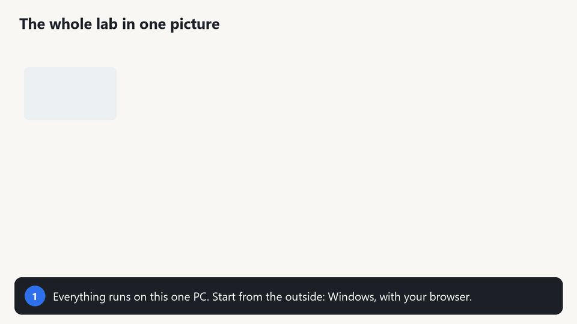
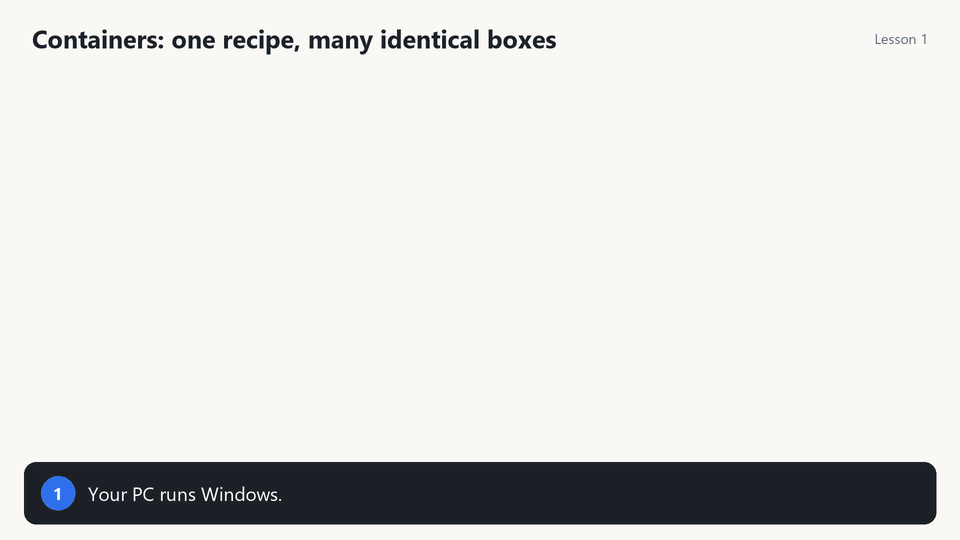
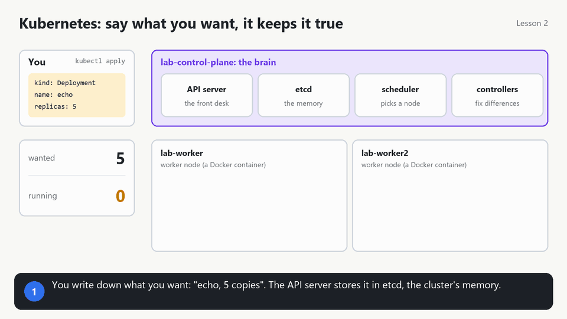
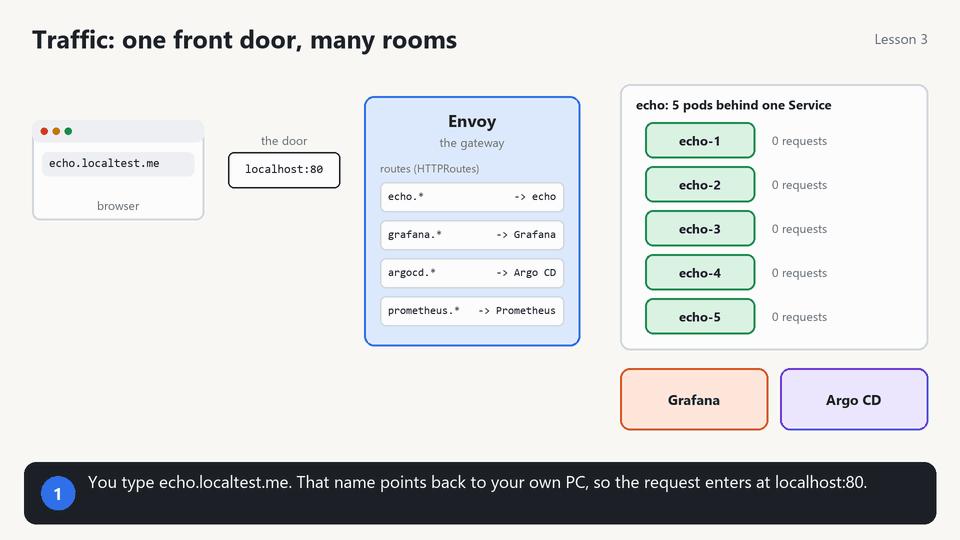
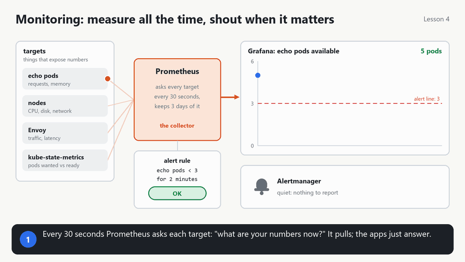
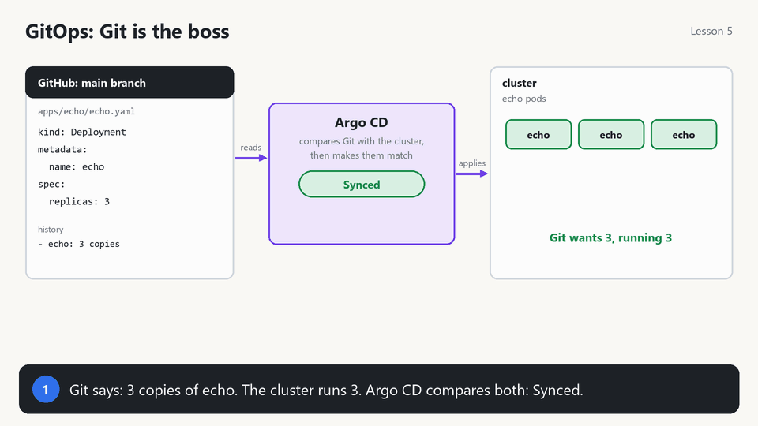
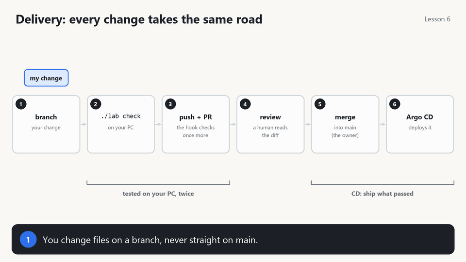
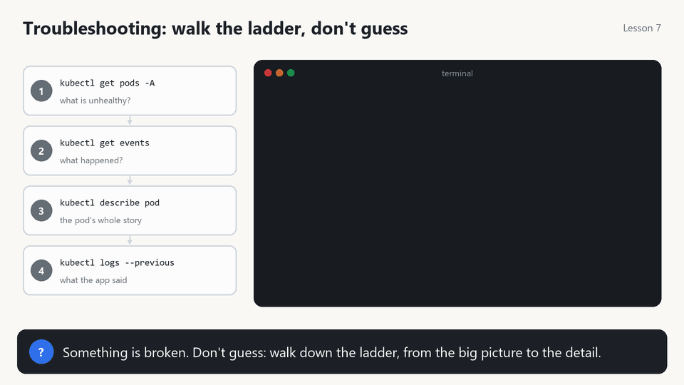

# devops-lab

A real Kubernetes platform that runs on one Windows PC, for free. Start it, break it, fix it, and learn how
each piece of a DevOps stack works.



## The stack, layer by layer

| # | Layer | Tools | In plain words | Learn |
|---|---|---|---|---|
| 1 | Containers | WSL2, Docker Engine | a sealed box that holds one app and runs the same everywhere | [lesson](docs/lessons/01-containers.md) · [handbook](docs/handbook/01-host.md) |
| 2 | Cluster | kind (3 nodes), kubectl, k9s | you say what you want; Kubernetes keeps it true | [lesson](docs/lessons/02-kubernetes.md) · [handbook](docs/handbook/02-cluster.md) |
| 3 | Traffic | MetalLB, Gateway API, Envoy | one front door, many rooms | [lesson](docs/lessons/03-traffic.md) · [handbook](docs/handbook/03-traffic.md) |
| 4 | Monitoring | Prometheus, Grafana, Alertmanager | measure all the time, shout when it matters | [lesson](docs/lessons/04-monitoring.md) · [handbook](docs/handbook/04-observability.md) |
| 5 | GitOps | Argo CD | Git is the boss: the cluster copies what `main` says | [lesson](docs/lessons/05-gitops.md) · [handbook](docs/handbook/05-gitops.md) |
| 6 | Delivery | `./lab check`, pre-push hook | every change takes the same road, tested on your PC (no CI) | [lesson](docs/lessons/06-delivery.md) · [handbook](docs/handbook/06-ci.md) |
| 7 | Troubleshooting | `./lab status`, kubectl | walk the ladder, don't guess | [lesson](docs/lessons/07-troubleshooting.md) · [handbook](docs/handbook/07-troubleshooting.md) |

The **lessons** are the gentle path: plain words, every term explained, one animation each. The
**handbooks** are the deep reference: every flag, trade-off and gotcha.

## Your day

Open a WSL terminal first (after a boot it asks for the SSH key passphrase), then `cd ~/devops-lab`.

| When | Run | What happens |
|---|---|---|
| The very first time | `./lab tools`, then `./lab up` | installs kubeconform and k9s, then builds the cluster and the whole platform (host setup: [handbook 1](docs/handbook/01-host.md)) |
| Start of the day | `./lab start` | starts the stopped cluster and waits until traffic flows (about 1 min) |
| Any time | `./lab status` | nodes, routes, unhealthy pods, Argo CD apps, the URLs |
| End of the day | `./lab turnoff` | stops the cluster cleanly, then shuts down WSL and frees the RAM |

## Every `./lab` command

| Command | What it does |
|---|---|
| `./lab start` | start of the day: brings the stopped cluster back, waits until traffic flows end to end |
| `./lab turnoff` | end of the day: `./lab stop`, then shuts down WSL (closes the terminal) |
| `./lab stop` | stops the cluster but leaves WSL running (state kept) |
| `./lab status` | nodes, gateway, routes, unhealthy pods, Argo CD apps, URLs |
| `./lab passwords` | Grafana and Argo CD admin passwords |
| `./lab check` | the test gate: shell lint + every manifest against its schema (the pre-push hook runs it too) |
| `./lab up` | builds or upgrades the whole platform; safe to run again |
| `./lab down` | deletes the cluster (`./lab up` rebuilds everything) |
| `./lab gitops` | gives Argo CD a fresh read-only deploy key, then applies the root app |
| `./lab tools` | installs kubeconform and k9s into `~/.local/bin` (no sudo) |
| `./lab help` | this list |

## Open in the browser

| URL | What | Login |
|---|---|---|
| http://echo.localtest.me/hostname | demo app: answers with the name of the pod that served you | none |
| http://grafana.localtest.me | dashboards | admin / `./lab passwords` |
| http://prometheus.localtest.me | metrics, targets, alerts | none |
| http://alertmanager.localtest.me | where alerts are routed | none |
| http://argocd.localtest.me | GitOps: the app tree and its health | admin / `./lab passwords` |

`*.localtest.me` is public DNS that points to 127.0.0.1, so no hosts-file edits.

## Make a change

Every change takes the same road. There is no CI: every test runs on your PC, before the push.

| Step | Command | Why |
|---|---|---|
| 1. Branch | `git switch -c fix/my-change` | never work on `main` |
| 2. Test | `./lab check` | catches a typo before the cluster sees it |
| 3. Push | `git push -u origin HEAD` | the pre-push hook runs `./lab check` again and refuses a red one |
| 4. Pull request | `gh pr create --fill` | the diff, ready to review |
| 5. Merge | `gh pr merge <number> --merge --delete-branch` | only the owner merges |
| 6. Deploy | nothing to run | Argo CD syncs `apps/` from `main` (a change in `platform/` or `cluster/` needs `./lab up`) |
| 7. Catch up | `git switch main && git pull` | your copy matches GitHub again |

Merge several PRs at once (put your PR numbers in the list):

```bash
for pr in 7 8 9; do gh pr merge "$pr" --merge --delete-branch; done
git switch main && git pull
```

The hook lives in `.git/hooks/pre-push` on this PC, not in the repo: a fresh clone needs it copied back
([handbook 6](docs/handbook/06-ci.md)).

## The animations

Click one to open its lesson.

<table>
<tr>
<td width="50%"><a href="docs/lessons/01-containers.md"></a><br><b>1. Containers</b>: one app in a sealed box</td>
<td width="50%"><a href="docs/lessons/02-kubernetes.md"></a><br><b>2. Kubernetes</b>: it keeps what you asked for true</td>
</tr>
<tr>
<td><a href="docs/lessons/03-traffic.md"></a><br><b>3. Traffic</b>: one front door, many rooms</td>
<td><a href="docs/lessons/04-monitoring.md"></a><br><b>4. Monitoring</b>: measure, then shout when it matters</td>
</tr>
<tr>
<td><a href="docs/lessons/05-gitops.md"></a><br><b>5. GitOps</b>: Git is the boss</td>
<td><a href="docs/lessons/06-delivery.md"></a><br><b>6. Delivery</b>: the same road for every change</td>
</tr>
<tr>
<td><a href="docs/lessons/07-troubleshooting.md"></a><br><b>7. Troubleshooting</b>: walk the ladder, don't guess</td>
<td></td>
</tr>
</table>

## How a request reaches a pod

```
 Windows browser                                   WSL2 (Ubuntu 24.04)
 http://*.localtest.me ──► localhost:80 ──► kind node "lab-control-plane" :80
                                              │ hostPort 80 → 10080
                                              ▼
                         ┌──────────── Envoy proxy (Gateway "lab") ─────────────┐
                         │  HTTPRoutes by hostname, per-request L7 balancing    │
                         └──┬──────────────┬──────────────┬──────────────┬──────┘
                            ▼              ▼              ▼              ▼
                       echo (x5)        Grafana       Prometheus      Argo CD
                     spread over      (monitoring)   Alertmanager    (argocd) ◄── GitHub repo (main)
                     both workers                                        │ syncs apps/
 MetalLB: the same Gateway also gets 172.18.255.200 (L2), reachable from WSL.
```

## If something is off

| Symptom | Do this |
|---|---|
| Nothing answers after a reboot | `./lab start` |
| One page does not load | `./lab status`: look at the unhealthy pods and the routes, then [lesson 7](docs/lessons/07-troubleshooting.md) |
| `git push` refused: "./lab check failed" | `./lab check`, read the error, fix it, commit, push again |
| Argo CD shows Degraded | the files were valid but the app is not: revert the commit ([lesson 5](docs/lessons/05-gitops.md)) |
| VS Code lost WSL after `./lab turnoff` | Command Palette → "Reload Window" |

## What's where

| Path | Owner | Content |
|---|---|---|
| `lab` | everyone | the single entry point; pinned platform versions at the top |
| `cluster/kind.yaml` | platform | node layout, port mappings |
| `platform/` | platform | MetalLB pool, Gateway + EnvoyProxy, monitoring and Argo CD values and routes |
| `apps/` | app teams | workloads, delivered by Argo CD |
| `gitops/root.yaml` | platform | the Argo CD root Application that watches `apps/` |
| `docs/lessons/` | everyone | the plain-word lessons and their GIFs (`make_gifs.py` redraws them) |
| `docs/handbook/` | everyone | the deep reference |
