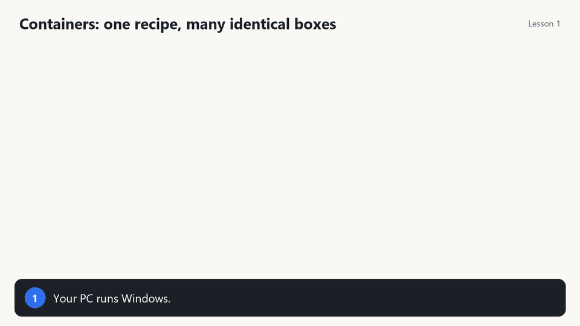

# Lesson 1: Containers (WSL2 and Docker)

> A container is a sealed box that holds one app and everything it needs, so the app runs the same way
> everywhere.



## The idea

Think of a recipe card and the dishes cooked from it.

- The **image** is the recipe card: the app's files and the command that starts it. It is frozen: nobody
  writes on it.
- A **container** is one dish cooked from that card. You can cook ten; they all come out the same.
- Spill sauce on one dish (write a file inside a container) and the card does not change. Throw the dish
  away and cook a new one: it comes out exactly like the first.

That is why containers matter: "it works on my machine" becomes "it works in this image", and the image is
the same on your PC, in CI and in production.

A container is **not** a virtual machine. A virtual machine boots a whole operating system. A container is
an ordinary Linux program with walls around it: it sees only its own files, its own network and its own list
of programs, and it may use only so much CPU and memory. Nothing to boot, so it starts in about a second.
(Linux calls those walls *namespaces* and the limits *cgroups*.)

Containers need Linux. Windows gets one through **WSL2**: a small, fast virtual machine running a real
Ubuntu, which you open like any terminal. Docker runs inside it.

## Words

| Word | Plain meaning |
|---|---|
| WSL2 | "Windows Subsystem for Linux": a real Linux running inside Windows |
| Docker Engine | the program that downloads images and starts containers |
| image | a frozen package: the app's files plus how to start it; read-only |
| layer | an image is a stack of layers (base files, the app, settings); images share common layers to save space |
| container | one running copy of an image, walled off from the others |
| registry | a shop for images, like Docker Hub or GitHub's GHCR; `docker pull` downloads from it |
| tag | the version label after the colon: `agnhost:2.53` |
| kernel | the core of Linux; all containers on a machine share the same one |

## In our lab

- WSL2 runs Ubuntu 24.04. It starts services with systemd, the same way a real Linux server does.
- Docker Engine (the server version, not Docker Desktop) runs inside it.
- The Kubernetes "servers" of lesson 2 are themselves Docker containers: `lab-control-plane`, `lab-worker`
  and `lab-worker2`.
- Anything that listens on a port inside WSL shows up on Windows `localhost`. That is how your Windows
  browser reaches the lab.
- No secret is kept as plain text: your GitHub login sits in an encrypted keyring, and your SSH key has a
  passphrase. That is why WSL asks for two passwords when it starts.

Deep dive: [handbook 1, the host](../handbook/01-host.md).

## Try it

1. In Windows PowerShell: `wsl -l -v`. You see `Ubuntu-24.04` with VERSION `2`.
2. In WSL: `uname -r`. The name ends in `microsoft-standard-WSL2`: a real Linux kernel.
3. `docker ps`: the three kind nodes, each one a container (the lab must be started).
4. See that a container's changes vanish:

   ```bash
   docker run --rm -it ubuntu:24.04 bash    # a fresh box from the ubuntu image
   echo hello > /note.txt; ls /note.txt; exit
   docker run --rm -it ubuntu:24.04 bash    # a new box from the same image
   ls /note.txt                             # "No such file": the image never changed
   exit
   ```

5. `docker images` lists the images on this PC; `docker history ubuntu:24.04` shows the layers of one.

## When it breaks

- **`permission denied ... docker.sock`**: you were added to the `docker` group, but your terminal is older
  than that change. In Windows: `wsl --terminate Ubuntu-24.04`, then open WSL again.
- **`wsl` won't start, error `Wsl/0x80070422`**: the WSL service is disabled in Windows. In an admin
  PowerShell: `Set-Service WSLService -StartupType Automatic; Start-Service WSLService`.
- **The PC feels slow**: WSL may take up to half the RAM, and the lab needs 4 to 5 GB of it. You can set a
  cap in `C:\Users\<you>\.wslconfig` (handbook 1 shows how).

## Check yourself

<details><summary>1. You change a file inside a container, delete the container, and start a new one from
the same image. Is your change there?</summary>

No. Changes live in the container's own scratch space, which is deleted with it; the image is read-only.
To keep a change, build it into the image (a Dockerfile) or store it in a volume.
</details>

<details><summary>2. Why does a container start faster than a virtual machine?</summary>

It boots no operating system. It is an ordinary program that shares the machine's Linux kernel, just walled
off from the others.
</details>

<details><summary>3. What is the difference between an image and a container?</summary>

The image is the frozen recipe (files plus the start command). A container is one running copy made from it.
One image, many containers.
</details>

Next: [Lesson 2: Kubernetes](02-kubernetes.md)
