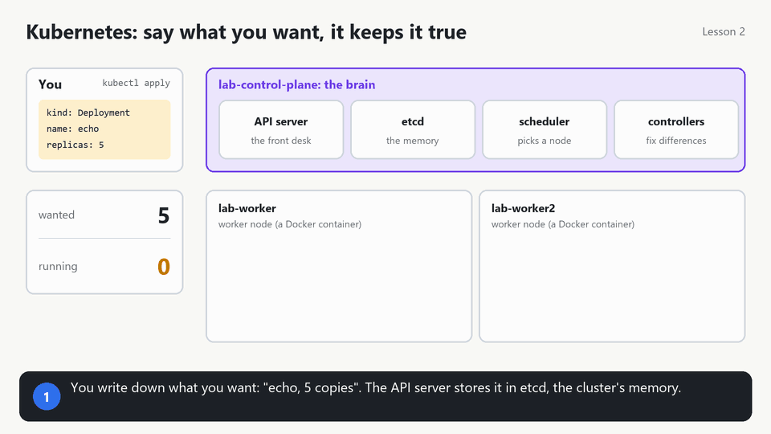

# Lesson 2: Kubernetes (with kind)

> Kubernetes runs your containers on a group of machines. You tell it what you want, and it works non-stop
> to keep that true.



## The idea

Imagine a restaurant manager with a notebook. You say: "I want 5 waiters on the floor at all times." The
manager writes it down, puts 5 waiters on the floor, then keeps looking. If one goes home sick, the manager
calls in another. You never say *how*; you only say *what*.

That is Kubernetes. You write what you want in a small text file (YAML): "run the echo app, 5 copies".
Kubernetes then:

1. stores your wish,
2. places the copies on machines that have room,
3. checks again and again that reality matches your wish, and fixes any difference.

Step 3 is called the **control loop** (or reconciliation). It is the heart of Kubernetes: almost every
feature you will meet works this way.

A **cluster** is the group of machines. It has two kinds of members:

- the **control plane**, the brain: it stores the wishes and makes the decisions;
- the **workers**, the hands: they run your containers.

Real clusters use real servers. Our lab uses **kind** ("Kubernetes in Docker"): each server is a Docker
container from lesson 1. Same software as a real cluster, all on one PC, for free.

## Words

| Word | Plain meaning |
|---|---|
| cluster | the group of machines Kubernetes manages |
| node | one machine in the cluster (here: one Docker container) |
| control plane | the brain: API server, etcd, scheduler and controllers |
| API server | the front desk: every command (`kubectl ...`) goes through it |
| etcd | the cluster's memory: a small database that stores every wish and every object |
| scheduler | picks which node runs each new pod |
| controller | a loop that compares "wanted" with "real" and fixes the difference |
| kubelet | the agent on each node that actually starts the containers |
| pod | the smallest thing Kubernetes runs: one container (sometimes a few) with its own IP address |
| Deployment | a wish like "keep 5 pods of this image running"; it also swaps pods safely when you change the image |
| ReplicaSet | the helper a Deployment uses to keep the count; you rarely touch it |
| manifest | the YAML file that describes what you want |
| kubectl | the command-line tool that talks to the API server |
| namespace | a folder inside the cluster to keep things apart (`default`, `monitoring`, `argocd`...) |

## In our lab

- [cluster/kind.yaml](../../cluster/kind.yaml): one control plane (`lab-control-plane`) and two workers
  (`lab-worker`, `lab-worker2`).
- The control plane carries a "no apps here" sign (a *taint*), so your apps run on the workers.
- [apps/echo/echo.yaml](../../apps/echo/echo.yaml) asks for 5 copies of `echo`, a tiny web app that answers
  with its own pod name. It also asks Kubernetes to *spread* the copies across nodes, so one node failing
  never takes them all down.

Deep dive: [handbook 2, the cluster](../handbook/02-cluster.md).

## Try it

1. `kubectl get nodes`: 3 nodes, all `Ready`.
2. `kubectl get pods -o wide`: 5 echo pods; the NODE column shows them spread over both workers (3 and 2).
3. Delete one and watch it come back:

   ```bash
   kubectl delete "$(kubectl get pod -l app=echo -o name | head -1)"
   kubectl get pods -l app=echo      # a new pod, with a new name, is already starting
   ```

4. Peek inside a node: `docker exec lab-control-plane crictl ps`. The brain's own parts (etcd,
   kube-apiserver, kube-scheduler...) are containers too.
5. `k9s` opens a friendly terminal screen: type `:pods` and Enter to list pods, `:q` to quit.

## When it breaks

- **A pod stays `Pending`**: the scheduler found no node for it (not enough memory, or a rule it cannot
  meet). `kubectl describe pod <name>`: the Events at the bottom say why, node by node.
- **A pod shows `CrashLoopBackOff`**: the app starts, then quits, again and again. Read its logs
  (lesson 7).
- **A node is `NotReady`**: the kubelet on that node stopped answering. In the lab, `docker ps` shows whether
  the node's container still runs; `docker start lab-worker` if it does not.

## Check yourself

<details><summary>1. You delete a pod that belongs to a Deployment. What happens, and why?</summary>

A new one appears within seconds. The Deployment still says "5 copies"; its controller counts 4 and creates
one more. You changed reality, not the wish.
</details>

<details><summary>2. What does the scheduler do, and what does it not do?</summary>

It only decides which node a new pod goes to. Starting the container is the kubelet's job on that node, and
keeping the count right is the controllers' job.
</details>

<details><summary>3. Where does Kubernetes remember what you asked for?</summary>

In etcd, the cluster's database. Everything reaches it through the API server.
</details>

Next: [Lesson 3: Traffic and load balancing](03-traffic.md)
