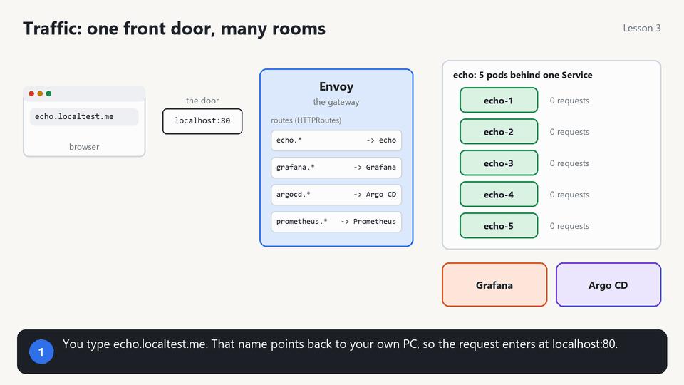

# Lesson 3: Traffic and load balancing

> Every request enters through one front door. A gateway reads the address, sends the request to the right
> app, and shares the work among that app's copies.



## The idea

Think of an office building with one entrance and a receptionist.

- All visitors come in through the **same door**.
- The **receptionist** asks "who are you here to see?" and points to the right floor. That is **routing**.
- If the team you are visiting has 5 people, the receptionist sends each new visitor to the next person in
  turn, so nobody is buried while others wait. That is **load balancing**.
- If someone is out sick, the receptionist stops sending visitors to them. That is a **health check**.

In the lab, the door is port 80 on your PC, the receptionist is **Envoy**, and the "who" is the name you
typed in the browser: `echo.localtest.me`, `grafana.localtest.me`...

Why those names? Every name ending in `.localtest.me` is public DNS that points to `127.0.0.1`: your own
PC. So the browser always knocks on the same door, and tells Envoy which app it wants in the **Host
header**, a line sent with every web request.

## Words

| Word | Plain meaning |
|---|---|
| port | a numbered door on a machine; web traffic uses 80 (HTTP) and 443 (HTTPS) |
| Host header | the name you typed, sent along with every web request |
| Service | a fixed name and address in front of a group of pods; pods come and go, the Service stays |
| endpoints | the current list of ready pod addresses behind a Service |
| gateway, Envoy | the receptionist: receives every request and forwards it |
| Gateway API | the Kubernetes way to set up that receptionist (the newer replacement for "Ingress") |
| HTTPRoute | one rule: "requests for this name go to that Service" |
| round robin | take turns: 1, 2, 3, 4, 5, 1, 2... |
| readiness probe | Kubernetes keeps asking the pod "are you ready?"; a "no" takes it out of the endpoints |
| MetalLB | gives a Service an IP address on the local network, the way a cloud load balancer would |

## In our lab

The path of one request:

```
browser → localhost:80 → WSL → lab-control-plane container :80 → Envoy → an echo pod
```

- Envoy runs on the control plane, the only node whose port 80 is published to WSL.
- [platform/envoy-gateway/gateway.yaml](../../platform/envoy-gateway/gateway.yaml) sets up the door: the
  Gateway named `lab`.
- Each app brings its own HTTPRoute. [apps/echo/echo.yaml](../../apps/echo/echo.yaml) says
  "`echo.localtest.me` goes to the Service `echo`".
- Envoy balances **per request**, round robin. A plain Kubernetes Service balances per *connection*: a
  browser that keeps its connection open would stick to one pod. Envoy avoids that.
- MetalLB also gives the gateway the address `172.18.255.200`, reachable from inside WSL only.

Deep dive: [handbook 3, traffic](../handbook/03-traffic.md).

## Try it

1. Open http://echo.localtest.me/hostname in the Windows browser: it shows a pod name. Refresh a few times:
   the name changes.
2. Count where 30 requests land:

   ```bash
   for i in $(seq 30); do curl -s echo.localtest.me/hostname; echo; done | sort | uniq -c
   ```

   Five names, about 6 each. Not exactly equal: Envoy runs several threads, and each keeps its own turn.
3. Prove that the name is what counts:

   ```bash
   curl -s -H 'Host: echo.localtest.me' localhost/hostname; echo                     # works
   curl -s -o /dev/null -w '%{http_code}\n' -H 'Host: nope.localtest.me' localhost   # 404: no route
   ```

4. `kubectl get httproute -A` shows one route per app.
   `kubectl get endpointslices -l kubernetes.io/service-name=echo` shows the 5 pod addresses Envoy picks
   from.

## When it breaks

- **404 from Envoy**: no route matches the name. A typo in the hostname, or the route is not attached:
  `kubectl describe httproute <name>` should say `Accepted` and `ResolvedRefs`.
- **503**: the route is fine, but no pod behind the Service is ready. `kubectl get pods`: are they Ready?
- **Nothing answers at all**: Envoy is not running on the control plane.
  `kubectl -n envoy-gateway-system get pods -o wide`.
- **Port 80 already in use** on Windows by another program: `netstat -ano | findstr :80` tells you which.

## Check yourself

<details><summary>1. Every app in the lab uses port 80. How does Envoy know which one you want?</summary>

From the name you typed: the browser sends it in the Host header, and an HTTPRoute maps each name to a
Service.
</details>

<details><summary>2. One echo pod stops answering its health check. Do users see errors?</summary>

Normally not. Its readiness probe fails, Kubernetes removes it from the endpoints, and Envoy stops sending it
requests until it recovers.
</details>

<details><summary>3. What is the difference between balancing per request and per connection?</summary>

Per request, each request can go to a different pod. Per connection, a client that keeps one connection open
(browsers, gRPC) keeps hitting the same pod, so the load can end up very uneven.
</details>

Next: [Lesson 4: Monitoring](04-monitoring.md)
