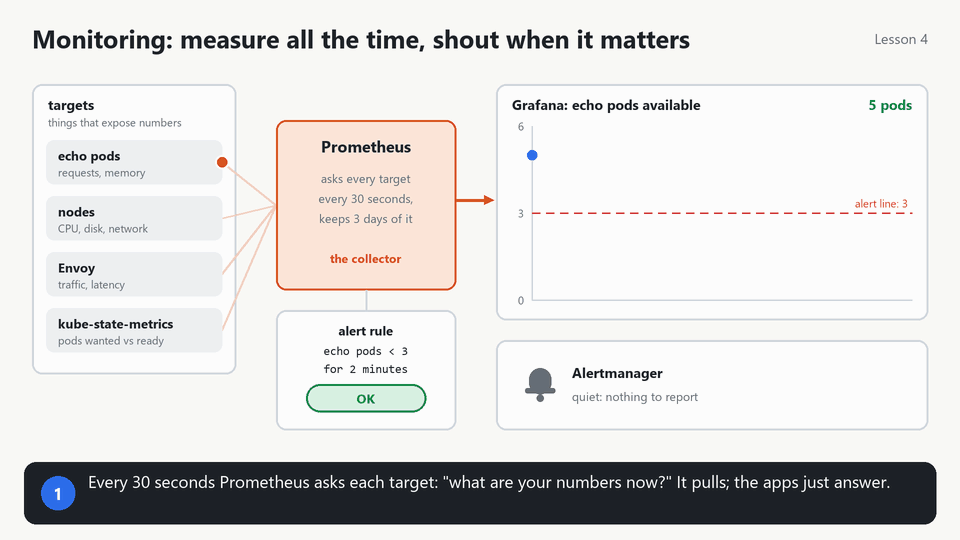

# Lesson 4: Monitoring (Prometheus, Grafana, Alertmanager)

> Prometheus collects numbers from everything, all the time. Grafana draws them. Alertmanager warns a human
> when a number stays bad.

## The idea

Think of a hospital ward.

- A nurse walks past every bed every few minutes and writes down each patient's pulse and temperature, with
  the time. That is **Prometheus**: every 30 seconds it visits every target and records its numbers.
- The chart at the foot of the bed shows how those numbers moved over the day. That is **Grafana**.
- A rule like "fever above 39 °C for more than 10 minutes: call the doctor" is an **alert rule**. The
  10 minutes avoid a call for a short spike.
- The person who decides *which* doctor to call, turns ten calls about one patient into one, and stays quiet
  during planned surgery is **Alertmanager**.

Note the direction: Prometheus *pulls* (it asks); the apps only answer at an address, usually `/metrics`.
A target that stops answering is itself a useful warning.

## Words

| Word | Plain meaning |
|---|---|
| metric | a named number that changes over time, e.g. `kube_deployment_status_replicas_available` |
| label | a tag on a metric that says what it is about: `{deployment="echo"}` |
| scrape | one visit by Prometheus to read a target's numbers |
| target | anything Prometheus scrapes: a pod, a node, Envoy... |
| exporter | a helper that turns something's state into metrics (node-exporter for machines, kube-state-metrics for Kubernetes objects) |
| PromQL | the language for asking Prometheus questions, like "requests per second, per app" |
| ServiceMonitor, PodMonitor | a small Kubernetes file that tells Prometheus "please scrape these" |
| alert rule | a PromQL condition plus how long it must stay true (`for: 2m`) |
| Pending, Firing | the rule is true but still waiting / true long enough: the alert goes out |
| dashboard | a page of graphs in Grafana |

## In our lab

- `./lab up` installs everything as one package, **kube-prometheus-stack**, in the `monitoring` namespace
  ([its settings](../../platform/monitoring/values.yaml)).
- Prometheus scrapes every 30 seconds and keeps 3 days of data.
- Grafana comes with about 30 ready-made dashboards for nodes, pods and Kubernetes itself.
- Alertmanager runs but has no receiver yet (no chat, no mail): alerts only show on its page. Adding one is
  an exercise in the handbook.
- The alert `Watchdog` always fires, on purpose: it proves the whole alert chain works.

| URL | What |
|---|---|
| http://prometheus.localtest.me | targets, queries, alert rules |
| http://grafana.localtest.me | dashboards (user `admin`, password from `./lab passwords`) |
| http://alertmanager.localtest.me | the alerts that are going out |

Deep dive: [handbook 4, observability](../handbook/04-observability.md).

## Try it

1. Open http://prometheus.localtest.me/targets: every target should be `UP`.
2. In Prometheus' query box, type `kube_deployment_status_replicas_available{deployment="echo"}` and press
   Execute: `5`. The Graph tab shows it over time.
3. Requests per second through Envoy, per app:
   `sum by (envoy_cluster_name) (rate(envoy_cluster_upstream_rq_total[1m]))`. Run the curl loop from
   lesson 3, then run the query again: the number climbs.
4. Grafana, Dashboards, *Kubernetes / Compute Resources / Namespace (Pods)*, namespace `default`: the CPU
   and memory of the echo pods.
5. http://alertmanager.localtest.me: `Watchdog` is there, firing, as it should be.
6. To watch your own alert fire: add the `EchoReplicasMissing` rule from the
   [handbook](../handbook/04-observability.md#alerts) under `apps/echo/`, then lower `replicas` to 2
   **in Git** (a PR). Lowering it with `kubectl scale` does not last: Argo CD puts it back within seconds
   (lesson 5).

## When it breaks

- **A target is DOWN**: Prometheus cannot read it. The targets page shows the error (wrong port name, wrong
  path, pod not running).
- **A graph is empty**: check the time range (top right in Grafana), and check that the same query returns
  something in Prometheus first.
- **An alert never fires**: look at http://prometheus.localtest.me/alerts. Is it Pending (waiting out its
  `for:` time), or is the condition not even true?

## Check yourself

1. Does an app send its numbers to Prometheus?

No. Prometheus pulls: it visits each target every 30 seconds, and the app only answers at its metrics
address.

2. Why does an alert rule have a <code>for: 2m</code>?

So that a short blip, like a pod restarting for 20 seconds, wakes nobody. The condition must stay true for
2 minutes before the alert fires.

3. What does Alertmanager do that Prometheus does not?

Prometheus decides that something is wrong (the rule). Alertmanager decides who gets told, groups similar
alerts into one message, and can silence them during planned work.

Next: [Lesson 5: GitOps](05-gitops.md)
