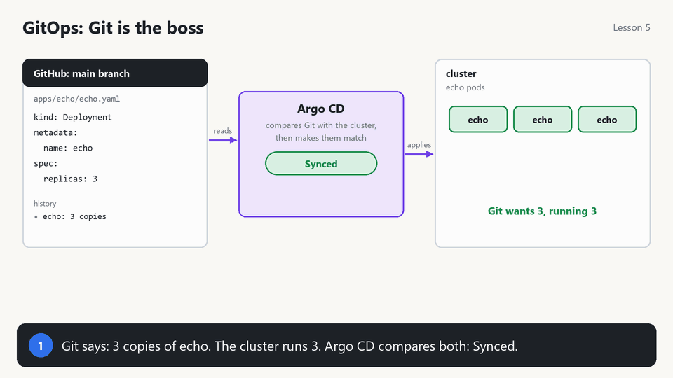

# Lesson 5: GitOps (Argo CD)

> Git holds the truth about what should run. Argo CD watches Git and makes the cluster match it, all the
> time.



## The idea

Think of an architect's plan and a building inspector.

- The **plan** is Git: "this wall, this window, 5 rooms".
- The **inspector** is Argo CD. It keeps walking the building with the plan in hand, and if the building
  differs from the plan, it fixes the building, never the plan.
- Want a 6th room? Change the plan (a pull request). The inspector sees the new plan and builds it.
- Someone knocks down a wall without changing the plan? The inspector puts it back.

So the cluster is always what Git says. Git's history tells you who changed what, when and why, and going
back is just `git revert`.

Without GitOps, people run `kubectl apply` from their laptops, and after a few months nobody knows what really
runs, or why. With GitOps, nobody applies apps by hand: you change Git.

## Words

| Word | Plain meaning |
|---|---|
| GitOps | running a system by changing Git, while a robot applies Git to the system |
| desired state | what Git says should run |
| live state | what really runs in the cluster |
| Application | an Argo CD object: "this folder of this repo goes into this cluster" |
| sync | applying what Git says to the cluster |
| Synced, OutOfSync | the cluster matches Git / the cluster differs from Git |
| Healthy, Progressing, Degraded | the app works / is still starting / is broken |
| selfHeal | Argo CD undoes changes made by hand |
| prune | a file deleted from Git gets its object deleted from the cluster |
| deploy key | a read-only key that lets Argo CD read this private repo |

## In our lab

- Argo CD runs in the `argocd` namespace. UI: http://argocd.localtest.me (user `admin`, password from
  `./lab passwords`).
- One root Application, `apps` ([gitops/root.yaml](../../gitops/root.yaml)), watches the `apps/` folder on
  `main`, with **selfHeal** and **prune** on.
- `./lab gitops` gives Argo CD a fresh read-only deploy key, then applies the root Application. Run it
  again after rebuilding the cluster.
- Not managed by Argo CD yet: `gitops/root.yaml` itself, and the platform (installed by `./lab up`). Who
  deploys the deployer? Here, you do, once. Moving the platform under Argo CD is a later step.

Deep dive: [handbook 5, GitOps](../handbook/05-gitops.md).

## Try it

1. Open http://argocd.localtest.me and click the `apps` tile. The tree shows Deployment, then ReplicaSet,
   then 5 pods, each with a green heart (Healthy).
2. Change something by hand and watch it being undone:

   ```bash
   kubectl scale deploy/echo --replicas=1
   kubectl get deploy echo -w        # 1, then back to 5 within seconds; Ctrl-C to stop watching
   ```

3. Change it the right way: on a branch, set `replicas: 4` in `apps/echo/echo.yaml`, open a PR, merge.
   In the UI: OutOfSync, Syncing, then Synced with 4 pods. Argo CD checks Git about every 3 minutes; the
   Refresh button checks now. Put it back to 5 the same way.
4. `kubectl -n argocd get applications`: `apps   Synced   Healthy`.

## When it breaks

- **The app shows `Unknown`, "repository not accessible"**: Argo CD's deploy key is missing or was revoked.
  Run `./lab gitops`.
- **Your change keeps disappearing**: that is selfHeal doing its job. Make the change in Git.
- **The app turns `Degraded` after a merge**: the new version is broken, for example an image tag that does
  not exist (`ImagePullBackOff`). Roll back by reverting the commit, not by clicking in the UI: Git stays
  the truth.

## Check yourself

<details><summary>1. You run <code>kubectl edit deploy/echo</code> and change the image. What happens?</summary>

Argo CD sees that the cluster differs from Git (OutOfSync) and, because selfHeal is on, changes it back
within seconds.
</details>

<details><summary>2. You delete <code>apps/echo/echo.yaml</code> from Git and merge. What happens to the echo pods?</summary>

They are deleted. Prune is on, so objects whose files left Git are removed from the cluster.
</details>

<details><summary>3. A bad version went out. What is the GitOps way to roll back?</summary>

Revert the commit in Git, through a PR. Argo CD then syncs the cluster back to the previous version, and the
history shows what happened.
</details>

Next: [Lesson 6: CI/CD](06-delivery.md)
