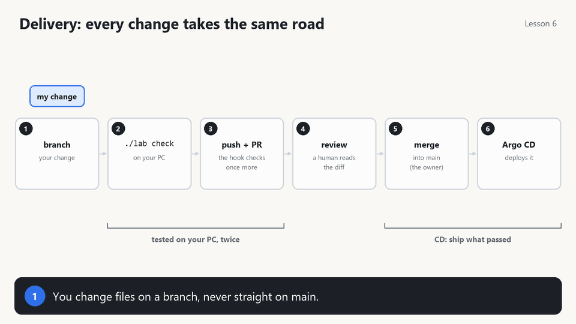

# Lesson 6: CI/CD (from your branch to the cluster)

> Every change takes the same road: a branch, an automatic check, a review, a merge. After the merge,
> Argo CD ships it.



## The idea

Think of a newspaper.

- A journalist writes on their own draft, never straight on the printed page: that is a **branch**.
- A spell checker runs before anyone else reads it: that is `./lab check` on your PC.
- The draft goes to the editor's desk: that is a **pull request** (PR).
- At the printing house, a checker runs the same spell check again on its own machine, so nothing slips
  through: that is **CI** (continuous integration).
- The editor reads it, and the chief editor decides to print: **review** and **merge**.
- The press prints what was approved: that is **CD** (continuous delivery). Here, Argo CD.

The main rule: `main` changes only through merged PRs, and CI runs exactly the same command as your PC.
One check, two places, no surprises.

## Words

| Word | Plain meaning |
|---|---|
| branch | your own line of work, separate from `main` |
| commit | one saved change, with a message saying why |
| pull request (PR) | a request to merge your branch into `main`, with the diff for others to read |
| CI | continuous integration: every change is tested automatically |
| CD | continuous delivery: what passed is shipped automatically |
| workflow | the GitHub Actions file that says what CI runs ([.github/workflows/ci.yml](../../.github/workflows/ci.yml)) |
| runner | the machine that runs the workflow; ours is your own WSL |
| lint, schema check | reading files for mistakes without running them |

## In our lab

- The check is `./lab check`. It reads the `lab` script for shell mistakes (shellcheck), and checks every
  Kubernetes file against its official format (kubeconform). A typo like `replcas: 5` fails here, not in
  the cluster.
- CI runs the same `./lab check` on every PR, on a **self-hosted runner**: your WSL. GitHub's own machines
  cost minutes on a private repo; ours cost nothing. `./lab check` even fails if a workflow tries to use
  GitHub's machines.
- Never attach a self-hosted runner to a public repo: anyone's PR could run code on your PC.
- While WSL is off, the runner is offline; CI jobs wait (up to 24 hours) and run once WSL is back.
- Only the owner merges. After the merge, Argo CD (lesson 5) deploys whatever changed in `apps/`.

Deep dive: [handbook 6, CI](../handbook/06-ci.md).

## Try it

1. `./lab check`: it ends with a kubeconform summary showing `Invalid: 0, Errors: 0`.
2. Break it on purpose (do not commit this):

   ```bash
   sed -i 's/replicas: 5/replcas: 5/' apps/echo/echo.yaml
   ./lab check                        # fails: "replcas" is not allowed
   git checkout apps/echo/echo.yaml   # undo
   ```

3. Is the runner alive? `systemctl status 'actions.runner.*'` should say `active (running)`.
4. The whole road for real: a branch, a small change (a typo in a doc), `./lab check`, push,
   `gh pr create --fill`, then `gh pr checks --watch` to see CI run on your own PC.

## When it breaks

- **A CI job stays "Queued"**: the runner is offline (WSL is off, or it lost its connection after a hard
  shutdown). Start WSL; if the job is still stuck, cancel it and run it again.
- **Green on your PC, red in CI**: something differs between the two, often a file you forgot to commit.
  Read the CI log, then `git status` locally.
- **kubeconform cannot download schemas**: it fetches them from the internet; check the connection.

## Check yourself

<details><summary>1. Why run the same check on your PC and in CI?</summary>

Your PC catches mistakes early, before anyone else sees them. CI makes sure nothing skips the check (a
forgotten run, a missing file). The same command in both places means no "but it worked for me".
</details>

<details><summary>2. Why does our CI run on WSL rather than on GitHub's machines?</summary>

It costs nothing: GitHub's machines have a limited free quota on private repos. The price: it only runs
while WSL is on, and it must never serve a public repo.
</details>

<details><summary>3. In this lab, which step actually deploys to the cluster?</summary>

None of the CI steps. Argo CD does, after the merge, by syncing `main`. CI only checks.
</details>

Next: [Lesson 7: Troubleshooting](07-troubleshooting.md)
