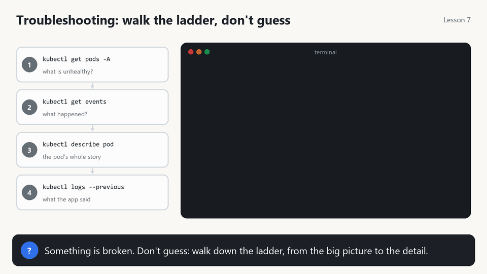

# Lesson 7: Troubleshooting

> When something breaks, don't guess. Go from the big picture to the detail, one step at a time, and let
> each step tell you where to look next.



(The animation is a made-up example of a typical crash; the "Try it" part below makes a real one.)

## The idea

Think of a doctor. They don't start with surgery. First "how do you feel?" (the big picture), then "what
happened today?" (events), then a full check-up (describe), and only then a specific test (logs). Each
answer narrows the search.

The ladder:

1. **`kubectl get pods -A`**: what is unhealthy? Which pod, in which namespace?
2. **`kubectl get events`**: what did Kubernetes see happen? Image pulls, crashes, scheduling failures.
3. **`kubectl describe pod <name>`**: the whole story of one pod: its settings, its state, its last events.
4. **`kubectl logs <name>`**: what the app itself said, before it died.

Two habits on top:

- Change **one** thing at a time, then check again.
- Fix the cause **in Git**, not by hand. Argo CD undoes hand fixes (lesson 5), and they leave no trace.

## Words

| Word | Plain meaning |
|---|---|
| event | a short note Kubernetes writes when something happens to an object; kept about an hour |
| Pending | the pod has no node yet: the scheduler cannot place it |
| ContainerCreating | the node is getting it ready (downloading the image...) |
| ImagePullBackOff | the image cannot be downloaded: wrong name or tag, or no access |
| CrashLoopBackOff | the app starts and crashes; Kubernetes waits longer and longer before each retry |
| OOMKilled | the app used more memory than its limit and was killed |
| exit code | the number a program returns when it stops: 0 means fine, anything else means an error |
| `--previous` | show the logs of the container *before* its last restart: the one that crashed |

## Pod states, and where to look

| You see | It usually means | Look at |
|---|---|---|
| `Pending` | no node fits (memory, rules) | `kubectl describe pod`: the Events |
| `ImagePullBackOff` | the image name or tag is wrong | `kubectl describe pod`: the Events |
| `CrashLoopBackOff` | the app itself fails | `kubectl logs <pod> --previous` |
| `OOMKilled` | the memory limit is too low, or the app leaks | `kubectl describe pod`: Last State |
| `Running` but `0/1` ready | the readiness probe fails | `kubectl describe pod`: the Events; then the logs |

## In our lab

- `./lab status` gives the overview: nodes, gateway, routes, Argo CD, and every pod that is not ready
  (crash-looping ones included).
- Recent events across the cluster: `kubectl get events -A --sort-by=.lastTimestamp | tail -20`.
- The [troubleshooting runbook](../handbook/07-troubleshooting.md) lists every problem this lab has
  actually had, with its fix.
- Reset levels, smallest first: restart one app (`kubectl rollout restart deploy/<name>`), rerun
  `./lab up`, rebuild everything (`./lab down && ./lab up`, then `./lab gitops`: about 5 minutes), or
  restart WSL (`wsl --shutdown` from Windows).

## Try it: break a pod on purpose

1. Start a pod that always crashes:

   ```bash
   kubectl run crashy --image=busybox:1.36 -- sh -c 'echo "Error: missing setting DB_HOST"; exit 1'
   ```

2. Wait about 30 seconds, then walk the ladder:

   ```bash
   kubectl get pods                    # crashy   0/1   CrashLoopBackOff
   kubectl get events --field-selector involvedObject.name=crashy
   kubectl describe pod crashy         # Last State: Terminated, Exit Code: 1
   kubectl logs crashy --previous      # Error: missing setting DB_HOST
   ```

3. Clean up: `kubectl delete pod crashy`. Argo CD leaves this pod alone, by the way: it only manages what is
   in Git.

## When troubleshooting itself gets stuck

- **`kubectl logs` shows nothing**: the container never started (`Pending`, `ImagePullBackOff`), so there
  is nothing to log. Go back to describe and events.
- **No events**: they expire after about an hour. Make the problem happen again, or look at its history in
  Grafana.
- **Every pod looks fine, but the site fails**: follow the request path from lesson 3: Envoy, the route,
  the Service, the pods.

## Check yourself

<details><summary>1. A pod is <code>Pending</code>. Will <code>kubectl logs</code> help?</summary>

No. The container never started, so it has no logs. `kubectl describe pod` shows the scheduler's reason in
the Events.
</details>

<details><summary>2. A pod is in <code>CrashLoopBackOff</code>. Which command helps most?</summary>

`kubectl logs <pod> --previous`: the logs of the container that crashed, where the app usually says why it
stopped.
</details>

<details><summary>3. You found the cause. Why fix it in Git rather than with <code>kubectl edit</code>?</summary>

Argo CD would undo the hand fix (selfHeal), and Git keeps a record of what changed and why.
</details>

Back to the [lessons index](README.md).
