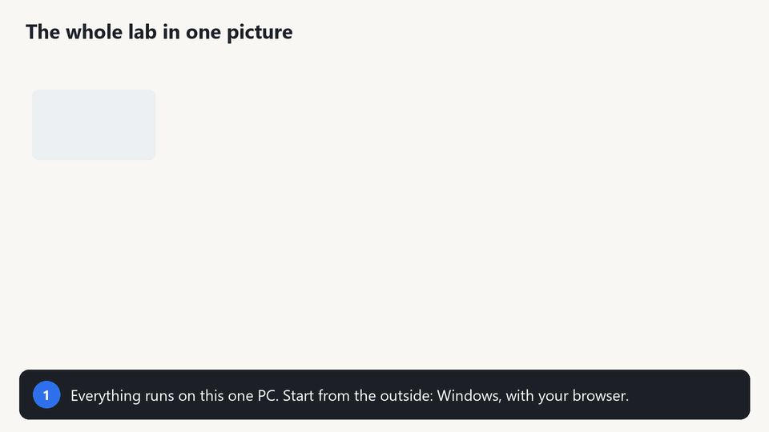

# Lessons: the lab, explained simply

Seven short lessons that explain every piece of this lab in plain words, each with an animation.
Read them in order: each one builds on the one before. About 10 minutes each, plus the "Try it" part.



| # | Lesson | In one line |
|---|---|---|
| 1 | [Containers: WSL2 and Docker](01-containers.md) | a sealed box that holds one app and runs the same everywhere |
| 2 | [Kubernetes with kind](02-kubernetes.md) | you say what you want; it keeps it true |
| 3 | [Traffic and load balancing](03-traffic.md) | one front door, many rooms |
| 4 | [Monitoring](04-monitoring.md) | measure all the time, shout when it matters |
| 5 | [GitOps with Argo CD](05-gitops.md) | Git is the boss |
| 6 | [CI/CD](06-delivery.md) | every change takes the same road, tested on your PC and by CI |
| 7 | [Troubleshooting](07-troubleshooting.md) | walk the ladder, don't guess |

## How each lesson works

- **The idea**: the concept, compared with something from everyday life.
- **Words**: every new word, in one plain line.
- **In our lab**: where that piece lives in this repo.
- **Try it**: a few commands to see it with your own eyes.
- **When it breaks**: what usually goes wrong, and the simple fix.
- **Check yourself**: three questions; click a question to see its answer.

The lessons are the gentle path. The [handbooks](../handbook/) are the deep reference: every flag, trade-off
and gotcha of the lab.

## Before "Try it"

The lab must be running. In WSL:

```bash
cd ~/devops-lab
./lab start      # after a ./lab stop or turnoff (the first time ever: ./lab up)
./lab status     # nodes, routes, Argo CD, and the URLs
```

At the end of the day: `./lab turnoff`.

## Remaking the animations

[make_gifs.py](make_gifs.py) draws every GIF with Python and Pillow. Each GIF is a short timeline with its
captions in the script: change a caption or a timing, then run it and commit the GIFs with the change.

```bash
python3 docs/lessons/make_gifs.py            # all of them
python3 docs/lessons/make_gifs.py gitops     # only the ones named
```

It needs Pillow: `sudo apt-get install -y python3-pil`, or `pip install pillow` in a virtualenv.
